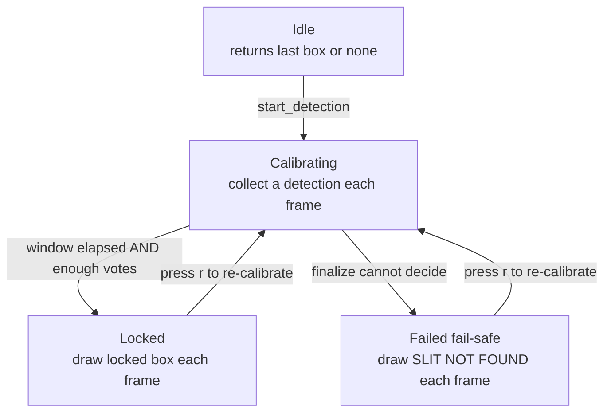
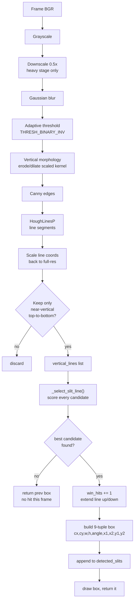
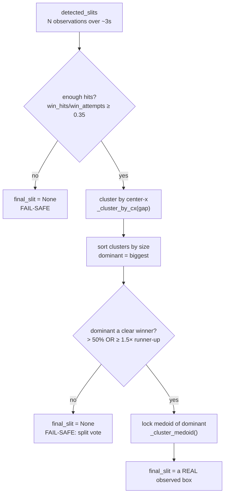

# How the Slit Detector Works

A walkthrough of `enhanced_slit_detection.py` — the module that finds the blade
**slit (kerf)** in the camera image and locks a "danger box" on it. This is the
hardest part of the safety system, so it gets its own document.

If you only read one thing: **the detector does not trust any single frame.** It
scores line candidates every frame by how much they *physically look like a groove*,
collects those detections over a few seconds, then locks the one the majority of
frames agreed on — or loudly gives up if the frames disagree.

---

## 1. Mental model

The kerf is a thin **dark vertical gap** cut into the table. In the image that means:

- it runs roughly **top-to-bottom** (vertical line),
- it is **darker than the material on *both* sides of it** (a groove, not a step-edge),
- it is usually somewhere **near the middle** of the frame (a mounting convention, not a law).

Everything the detector does is built to find *that* and to reject look-alikes — the
machine fence, a table seam, a frame border, a shadow — which satisfy *some* of those
but not all three.

Two design rules you'll see everywhere in the code:

1. **No absolute pixel values.** No "the slit is at x=640" and no "the slit is darker
   than gray value 80." Every cue is **relative** (a contrast *ratio*, a fraction of
   frame width/height). That's what lets the same code work on a different bandsaw,
   camera, or lighting.
2. **Loud failure beats a confident wrong answer.** For a safety device, a box on the
   wrong line is worse than no box. When unsure, it shows *"SLIT NOT FOUND"* and the
   caller drives the red LED.

---

## 2. The three states

`SlitDetector` is a small state machine. `detect_slit(frame)` is called once per frame
and behaves differently depending on the state:



| State | `is_active` | `is_finalized` | `final_slit` | What a frame does |
|---|---|---|---|---|
| **Idle** | `False` | `False` | — | returns the last box (if any), else `None` |
| **Calibrating** | `True` | `False` | — | run full detection, **store** this frame's detection |
| **Locked** | — | `True` | a 9-tuple | just draw the locked box, return it |
| **Failed (fail-safe)** | — | `True` | `None` | draw the red banner, return `None` → `is_slit_missing()` is `True` |

The switch happens in `detect_slit`: finalize fires once **both** conditions hold —
`stabilization_time` seconds have passed **and** at least `min_calib_hits` (20)
frames voted with a groove detection. The vote requirement exists because the
window is *wall-clock* based: on the live Pi the loop shares the CPU with
MediaPipe, recording and the GUI, so 5 seconds can mean only a handful of frames —
and a consensus over so few samples is hostage to one blurry/sawdust frame.
(Recordings replay much faster than live capture, which is exactly why clips
looked fine while the live feed didn't.) If votes are short when time is up,
calibration simply **keeps collecting** (the monitor shows *"CALIBRATING
(gathering frames)"*) — up to a hard cap of `max_calib_factor` (3×) the window,
after which it finalizes regardless and lets the fail-safe judge the weak
evidence. A slit-less scene therefore still fails **loud**, just a little later;
it can never hang in calibration forever.

---

## 3. The full pipeline (one calibration frame)

This is what happens for a single frame *while calibrating* — the interesting path.



### Stage-by-stage

**a. Grayscale + downscale + blur** (`detect_slit`). Color is irrelevant to a groove;
blur removes speckle that would create junk edges. For live-fps speed the heavy
candidate-search stage (blur → threshold → morphology → Canny → Hough) runs on a
copy **downscaled by `proc_scale` (0.5)**, with the spatial parameters (kernel
height, Hough vote/length/gap) scaled to match, and the resulting line
coordinates scaled back up afterwards. Crucially, everything that *decides which
candidate wins* — groove-ratio scoring, selection, extension — still runs on the
**full-resolution** gray image, so this halving costs ~2.2× less time
(72 → 32 ms/frame on the Pi 5) without changing detection quality (verified
frame-for-frame against the field recordings).

**b. Adaptive threshold** (~line 608). `THRESH_BINARY_INV` with a *local* mean makes
dark things white on a black background, *locally* — so it survives uneven lighting
across the table (one side brighter than the other). This is the first "relative not
absolute" step.

**c. Vertical morphology** (~line 618). A tall, 1-pixel-wide kernel `(25, 1)` erodes
then dilates. This **keeps vertical structure and kills horizontal structure** — it
bridges small gaps in a broken kerf and erases horizontal seams. This is why the
detector is "vertical": it's literally tuned to top-to-bottom features.

**d. Canny + HoughLinesP** (~lines 634–642). Standard edge → line-segment detection.
Thresholds are deliberately *loose* (`threshold=40`, `minLineLength=40`,
`maxLineGap=50`) so we get **many** candidate segments; we'd rather over-collect and
filter smartly than miss the kerf.

**e. Vertical filter** (~lines 657–688). Each Hough segment is kept only if it is
strongly vertical: `dy >= 1.5*dx` **and** `|angle| >= 45°`. Segments are flipped so
they always run top→bottom, then stored as `(x1, y1, x2, y2, angle)` in `vertical_lines`.

**f. Scored selection** — `_select_slit_line()`. This is the heart of the detector and
gets its own section below.

**g. Extend + build box** (~lines 710–802). Once the best candidate is chosen, nearby
collinear segments extend it up/down (a kerf is often broken into pieces), and it's
turned into the **9-tuple** box (see §7). That tuple is appended to `detected_slits`
*before* any display smoothing, so the accumulator holds raw observations.

---

## 4. The core idea: scoring, not "longest line"

The naive approach — "pick the longest vertical line" — fails, because the machine
fence and the frame border are long, straight, and vertical. So instead every
candidate gets a **score** in `_select_slit_line()` (line ~425):

```
score = groove  ×  (1 + 0.5·len_norm)  ×  center_factor
         ▲              ▲                    ▲
    PRIMARY cue     mild length boost    soft center bias
   (must be > 0)    (0..1 of frame H)   (1.0 center → 0.5 edge)
```

with two **hard** gates applied first:

- **Frame-edge reject** (line ~445): a line whose midpoint is within ~3% of the border
  is thrown out — that's a frame edge, not the slit.
- **Groove gate** (line ~448): if `groove < 0.05` the candidate is discarded outright.
  A line that isn't a groove is never the slit, no matter how long or centered.

Note what is **not** in the score: absolute position, absolute brightness. `len_norm`
is length ÷ frame height; `center_factor` is a fraction of frame width; `groove` is a
contrast ratio. All relative → all portable.

If no candidate survives the gates, `_select_slit_line` returns `None`, this frame
records **no hit**, and the detector keeps the previous box.

### 4.1 The groove ratio — the one universal cue

`_groove_ratio()` (line ~389) answers: *"is this line darker than the table on **both**
sides?"* That is the one thing physically true of every kerf and false of every
step-edge.

It walks 15 points along the line. At each point it looks `flank` pixels left and right
(`flank ≈ 1.2% of frame width`) and compares brightness:

```
   brightness across the line          brightness across a fence (step-edge)

   left   center   right               left   center   right
   ▓▓▓     ░░       ▓▓▓                 ▓▓▓     ░░       ░░
   material  gap   material             material edge   (also dark)

   darker than BOTH flanks  ✔ groove    darker than only ONE flank  ✘ not a groove
```

For each sample it takes the **shallower** (brighter) of the two flanks and computes
`(min_flank − center) / min_flank` — a **contrast ratio**, not a brightness. A fence is
dark on only one side, so `min_flank` (the still-bright side) ≈ center and the ratio is
~0. A clean deep kerf scores up to ~0.5. Samples that aren't darker than both flanks are
skipped, and if fewer than 40% of samples qualify, the groove score is 0 (the darkness
must be *consistent along the whole run*, not just one spot).

This is why a shadow or a one-sided edge can't win: it isn't a groove.

---

## 5. Locking a stable answer across frames

A single frame can be blurred, glared, or briefly occluded by the operator's hand. So
the detector never locks on one frame. During calibration it appends every frame's
detection to `detected_slits`. When time is up **and at least `min_calib_hits` (20)
frames have voted** (see §2 — at low live fps the window extends itself, capped at
3×, so the vote is never starved), `_finalize_detection()` decides.



### 5.1 Why cluster?

Vertical candidates differ mainly in **horizontal position**. If half the frames locked
onto the real kerf at x≈600 and half onto a seam at x≈900, averaging them would put the
box at x≈750 — **on neither line**, right over safe material. Catastrophic for a safety
box.

`_cluster_by_cx()` (line ~308) groups detections whose center-x are within `gap` pixels
(`gap = max(40, 6% of frame width)`). The kerf and the seam land in **separate**
clusters. We take the **biggest** cluster — whichever line the majority of frames saw.

### 5.2 Why the medoid, not the average?

`_cluster_medoid()` (line ~321) returns the **actual observed detection closest to the
cluster's median** — a real box some real frame produced, never a synthesized average.

```
   cluster of detections (• = one frame's box center)

        •  • •• •••• • ••  •            average → could be an x
        └───────┬───────┘                        no frame actually saw
              medoid  ← we pick this real one, nearest the median
```

Benefits: the locked box can't drift *between* observations, its angle stays consistent
with its own endpoints (no angle-wraparound averaging bugs), and the result is
**reproducible** to a few pixels run-to-run.

### 5.3 The fail-safe — three ways to say "I don't know"

`final_slit` is set to `None` (→ `is_slit_missing()` returns `True` → red banner) when:

1. **No groove ever found**, or found in **too few frames**: `win_hits / win_attempts <
   0.35` (`min_hit_frac`). The kerf must show up consistently, not once.
2. **Split vote**: the dominant cluster is *not* a majority **and** *not* clearly bigger
   than the runner-up (`len(dom) ≤ 0.5·N and len(dom) < 1.5·runner_up`, line ~363). The
   frames genuinely disagree about *which* line is the slit.

In all cases the detector refuses to guess. `_draw_no_slit_warning()` paints the red
*"SLIT NOT FOUND — CHECK CAMERA MOUNT"* banner and `detect_slit` returns `None`.

> **Known limit:** a steep, oblique (side-on) mount can still produce *one* stable,
> confident-but-wrong groove (e.g. a table-plate seam). The fail-safe only fires when
> the detector is *undecided* — it can't catch a stably-wrong lock. The defense is the
> **mounting guideline (mount overhead)**, documented in `CLAUDE.md`, not a code knob.

---

## 6. How the caller uses it

In `bandsaw_monitor.py` the loop does, roughly:

```python
slit, frame = detector.detect_slit(frame)
if detector.is_slit_missing():
    alert.solid_red()          # we can't protect what we can't locate
elif slit is not None:
    # check hand bboxes vs the slit box; red if a hand overlaps, else white/green
```

`is_slit_missing()` (line ~376) is the single boolean the rest of the system needs to
respect the fail-safe. *(Wiring this into the production red-LED path is a listed TODO —
see `SLIT_DETECTION_SUMMARY.md`.)*

One more live-fps courtesy from the caller: **while the detector is calibrating**,
`bandsaw_monitor.py` runs MediaPipe hand detection only every 3rd frame
(`HAND_DETECT_EVERY_N_CALIB`), reusing the last hand boxes in between so alerts
still fire. MediaPipe is by far the heaviest stage of the loop, and during
calibration the detector needs as many frames as possible for a well-sampled
vote. Once the slit is locked, hands are checked on every frame as before.

---

## 7. The data format (the 9-tuple)

Every detection and the final lock is a flat 9-tuple:

```
(cx, cy, width, height, angle, x1, x2, y1, y2)
 │   │    │      │       │     └──────┬──────┘
 │   │    │      │       │       line endpoints (top & bottom of the kerf)
 │   │    │      │       └ degrees, near ±90 (vertical)
 │   │    │      └ box thickness (fixed ~25 px across the kerf)
 │   │    └ box length (kerf length × 1.1)
 │   └ center y
 └ center x   ← clustering key; the most important number
```

Flat (not nested) so it serializes cleanly. `smooth_data()` also accepts a legacy
5-tuple and an older nested format for backward compatibility, but new code emits the
9-tuple.

---

## 8. Tuning knobs (all relative → portable)

You should rarely need these, but if you do, here's what each one trades off:

| Knob | Where | Default | Effect |
|---|---|---|---|
| `stabilization_time` | constructor / `--stabilization` | 5.0 s | longer = more frames to vote, slower to lock |
| `min_calib_hits` | `__init__` | 20 | minimum groove votes before locking; window extends at low live fps until reached |
| `max_calib_factor` | `__init__` | 3.0 | hard cap on the extension (× `stabilization_time`); then finalize regardless (fail-safe judges) |
| `proc_scale` | `__init__` | 0.5 | downscale factor for the heavy candidate-search stage; 1.0 = full-res (slower) |
| `min_hit_frac` | `__init__` (line ~193) | 0.35 | how consistently the kerf must appear or it's a fail-safe |
| `min_groove` | `_select_slit_line` (line ~438) | 0.05 | groove gate; raise to reject faint grooves |
| `center_weight` | `_select_slit_line` (line ~438) | 0.5 | how strongly center is preferred (soft) |
| `len_weight` | `_select_slit_line` (line ~438) | 0.5 | how much length is rewarded |
| cluster `gap` | `_finalize_detection` (line ~355) | `max(40, 6%·W)` | how far apart two lines must be to count as different slits |
| `flank` | `_groove_ratio` (line ~403) | `1.2%·W` | how far out to sample for the groove contrast |
| vertical kernel | `detect_slit` (line ~618) | `(25, 1)` | taller = bridges bigger gaps, more vertical bias |

---

## 9. Glossary

- **Kerf / slit** — the thin gap the blade cuts; what we're locating.
- **Groove** — a line that is darker than its material on *both* sides (a kerf); vs a
  **step-edge** (fence/body), dark on only one side.
- **Candidate** — a near-vertical Hough line segment that might be the kerf.
- **Cluster** — candidates at a similar horizontal position, grouped together.
- **Medoid** — the real cluster member nearest the cluster center (vs a computed mean).
- **Calibration / stabilization window** — the few seconds after `start_detection()`
  during which detections are collected before locking.
- **Fail-safe** — the state where no confident slit was found; `final_slit is None`,
  red banner shown.

---

*See also: [`SLIT_DETECTION_SUMMARY.md`](SLIT_DETECTION_SUMMARY.md) (why it was built
this way / project history) and [`CLAUDE.md`](CLAUDE.md) (system architecture and the
mounting guideline).*
